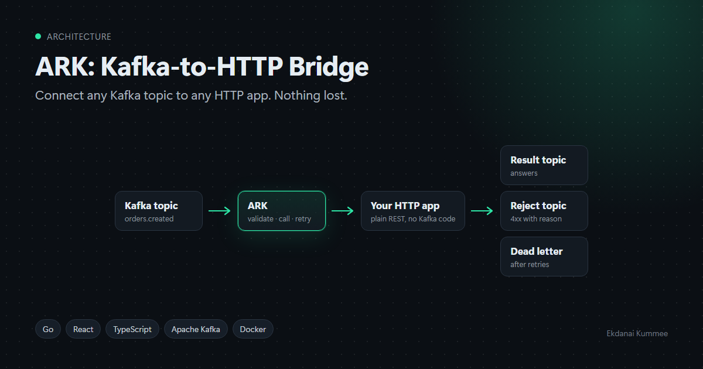
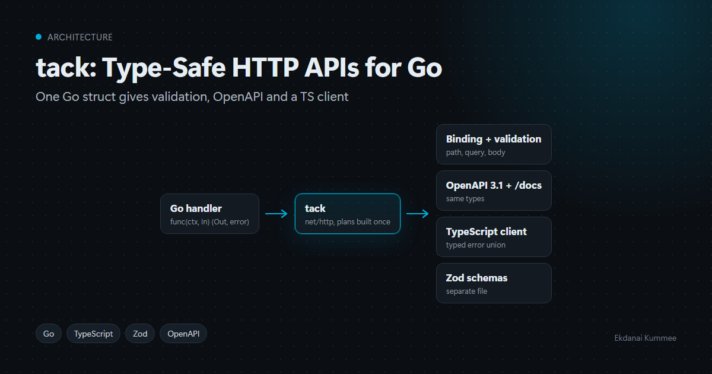
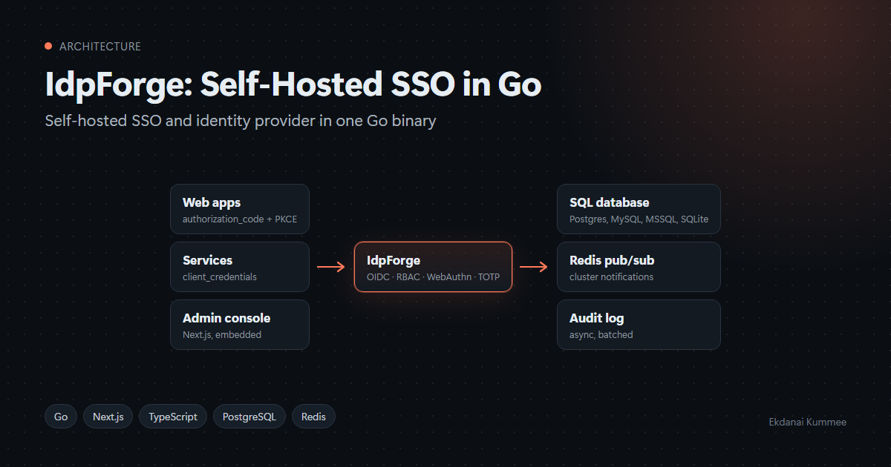
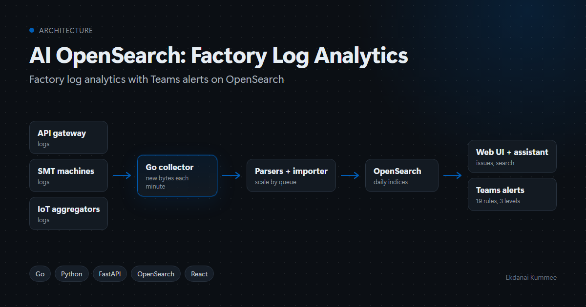
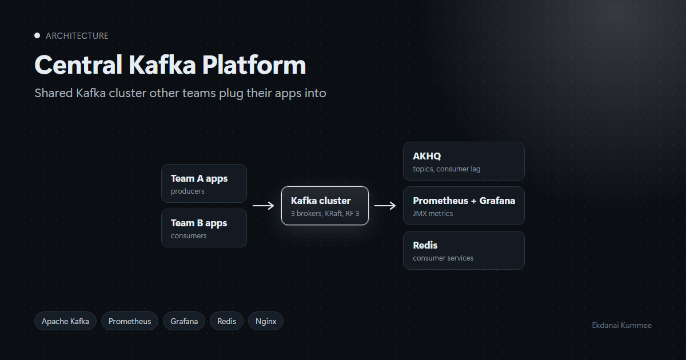
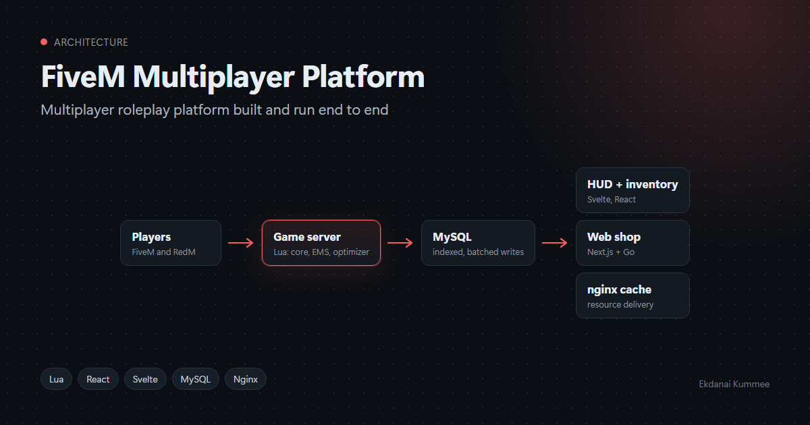
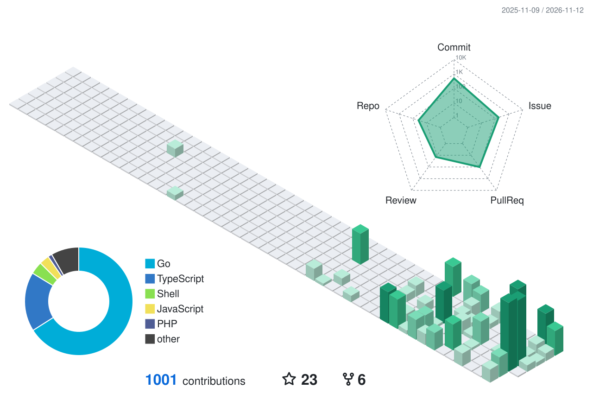

<picture>
  <source media="(prefers-color-scheme: dark)" srcset="./assets/header-dark.svg">
  
</picture>

<picture>
  <source media="(prefers-color-scheme: dark)" srcset="https://readme-typing-svg.demolab.com/?lines=Central+Kafka+and+NiFi+platforms;Go+services+and+Kubernetes+delivery;React+consoles+for+real-time+systems;Log+analytics+on+OpenSearch;Five+years+of+multiplayer+game+servers&font=Fira+Code&size=17&pause=1200&color=2EE6A6&center=true&vCenter=true&width=640&height=36">
  
</picture>

 

## About

- Application Engineer on the IT manufacturing systems team at Delta Electronics Thailand: CI/CD, Kubernetes, full-stack web, and production line support for MES tooling in an air-gapped network.
- I build and run the shared data platforms other teams plug into: a central Kafka cluster, a NiFi cluster, streaming pipelines out of the MES, and a log analytics platform on OpenSearch.
- I usually own what I build end to end, from scoping and cross-department coordination to presenting it and supporting the people who use it.
- Before corporate work I spent five years founding and operating a multiplayer game-server platform (FiveM and RedM), which is where most of my backend and systems experience started.

 

## Tech Stack

<table>
<tr>
<td align="right"><b>Languages</b></td>
<td></td>
</tr>
<tr>
<td align="right"><b>Frontend</b></td>
<td></td>
</tr>
<tr>
<td align="right"><b>Backend</b></td>
<td></td>
</tr>
<tr>
<td align="right"><b>Data and messaging</b></td>
<td></td>
</tr>
<tr>
<td align="right"><b>Infrastructure</b></td>
<td></td>
</tr>
<tr>
<td align="right"><b>Tools</b></td>
<td></td>
</tr>
</table>

 

## Featured Projects

<table>
<tr>
<td width="33%" valign="top">

<h3 align="center"><a href="https://github.com/raven-clown/ark">ARK</a></h3>

  

Kafka-to-HTTP bridge. Retries, dead letters, flows, cluster mode and a live console. One binary, one YAML file.

</td>
<td width="33%" valign="top">

<h3 align="center"><a href="https://github.com/raven-clown/tack">tack</a></h3>

  

Type-safe HTTP APIs for Go. Declare a struct once and get validation, OpenAPI docs, a TypeScript client and Zod schemas.

</td>
<td width="33%" valign="top">

<h3 align="center"><a href="https://github.com/raven-clown/idpforge">IdpForge</a></h3>

  

Self-hosted SSO and identity platform. OIDC, RBAC, realtime fan-out, and cluster-safe background jobs.

</td>
</tr>
<tr>
<td width="33%" valign="top">

<h3 align="center"><a href="./experience/delta-electronics">AI OpenSearch</a></h3>

  

Log analytics for the factory. Go collectors and workers, OpenSearch indices, and Teams alerts while production is still affected.

</td>
<td width="33%" valign="top">

<h3 align="center"><a href="./experience/delta-electronics">Central Kafka Platform</a></h3>

  

Shared Kafka and NiFi platforms other IT teams plug into, with CDC from the MES, Spark streaming jobs and Grafana monitoring.

</td>
<td width="33%" valign="top">

<h3 align="center"><a href="./experience/fivem-redm-platform">FiveM Platform</a></h3>

  

A multiplayer roleplay platform I founded and ran for five years: game server, Lua systems, web shop and infrastructure.

</td>
</tr>
</table>

More: <a href="./experience/side-projects">side projects</a> · <a href="./experience/delta-electronics">work at Delta</a> · <a href="./experience/architecture.md">architecture diagrams</a> · <a href="./experience/academic-projects">academic projects</a>

 

## Open Source

Merged upstream in projects I use.

<table>
<tr>
<td width="33%" valign="top">
<h3 align="center"><a href="https://github.com/mark3labs/mcp-go">mark3labs/mcp-go</a></h3>

The streamable HTTP client now reports the real HTTP status when a gateway or framework answers with a JSON error body, instead of failing with an unrelated parse error.

</td>
<td width="33%" valign="top">
<h3 align="center"><a href="https://github.com/mark3labs/mcp-go">mark3labs/mcp-go</a></h3>

A flaky SSE transport test raced a 1 ns client timeout against a mock server and panicked on a nil error about half the time on Windows. It is deterministic now.

</td>
<td width="33%" valign="top">
<h3 align="center"><a href="https://github.com/mark3labs/mcp-go">mark3labs/mcp-go</a></h3>

Tools no longer send an empty <code>annotations</code> object, and the new <code>WithoutDefaultAnnotations()</code> drops the default hints, so clients can tell an annotated tool from one without hints.

</td>
</tr>
<tr>
<td width="33%" valign="top">
<h3 align="center"><a href="https://github.com/mark3labs/mcp-go">mark3labs/mcp-go</a></h3>

Clients accept a tool result that only has <code>structuredContent</code>, instead of failing with <code>content is missing</code>.

</td>
<td width="33%" valign="top">
<h3 align="center"><a href="https://github.com/mark3labs/mcp-go">mark3labs/mcp-go</a></h3>

Decoding a notification into a reused value no longer keeps <code>_meta</code> and fields left over from the previous notification.

</td>
<td width="33%" valign="top">
<h3 align="center"><a href="https://github.com/mark3labs/mcp-go">mark3labs/mcp-go</a></h3>

Each replay callback gets its own copy of a stored event, so a callback that changes a message can no longer corrupt what later replays send.

</td>
</tr>
<tr>
<td width="33%" valign="top">
<h3 align="center"><a href="https://github.com/mark3labs/mcp-go">mark3labs/mcp-go</a></h3>

OAuth with PKCE enabled now refuses an empty code challenge or verifier, instead of quietly finishing the flow without PKCE.

</td>
<td width="33%" valign="top">
<h3 align="center"><a href="https://github.com/mark3labs/mcp-go">mark3labs/mcp-go</a></h3>

Requests are no longer parsed several times on the way to the handler. Profiling showed those extra JSON reads took most of the time and memory on large tool calls.

</td>
<td width="33%" valign="top">
<h3 align="center"><a href="https://github.com/mark3labs/mcp-go">mark3labs/mcp-go</a></h3>

The client listener keeps the retry interval it was created with instead of reading a package variable, which fixes an intermittent <code>go test -race</code> failure.

</td>
</tr>
<tr>
<td width="33%" valign="top">
<h3 align="center"><a href="https://github.com/grafana/mcp-grafana">grafana/mcp-grafana</a></h3>

Tool calls with a custom TLS config or a SOCKS5 proxy share one transport instead of building a new one each time. 300 calls open 1 connection instead of 300, and each call is about 25 times faster.

</td>
<td width="33%" valign="top">
<h3 align="center"><a href="https://github.com/Sriram-PR/doc-scraper">Sriram-PR/doc-scraper</a></h3>

Markdown converters are pooled, so crawls keep scaling past 8 workers. The maintainer measured about 905 pages per second at 32 workers, against 559 before.

</td>
<td width="33%" valign="top">
<h3 align="center"><a href="https://github.com/joshmedeski/sesh">joshmedeski/sesh</a></h3>

Window, pane and session lookups use the configured <code>tmux_command</code>, so another multiplexer such as psmux works for every command, not only some.

</td>
</tr>
<tr>
<td width="33%" valign="top">
<h3 align="center"><a href="https://github.com/thebanri/limoni">thebanri/limoni</a></h3>

Tests for the accessibility package of a Go terminal UI engine: value redaction, screen reader announcements on three platforms, and mode switches. Coverage went from 65% to 91%.

</td>
</tr>
</table>

 

## Activity

<picture>
  <source media="(prefers-color-scheme: dark)" srcset="./generated/snake-dark.svg">
  
</picture>

<table>
<tr>
<td width="33%"></td>
<td width="33%"></td>
<td width="33%"></td>
</tr>
</table>

 

## This Repository

| Folder | What's inside |
|---|---|
| [`experience/`](./experience) | The portfolio: what I built, where, and what came out of it |
| [`brain/`](./brain) | The knowledge base: how each skill area works, in detail |
| [`about/`](./about) | How I work and background outside the job title |

**Education:** B.Sc. Digital Business Technology, Southeast Bangkok University, 2025 (First Class Honors, Gold Medal)

 

Open to interesting backend, platform and data engineering work. Reach me at [ekdanai.kk@gmail.com](mailto:ekdanai.kk@gmail.com).

<picture>
  <source media="(prefers-color-scheme: dark)" srcset="./assets/footer-dark.svg">
  
</picture>
