# System Architecture

Diagrams of the systems described across this repository. The front page keeps the summary; this page keeps the drawings.

### [ARK](https://github.com/raven-clown/ark): From a Topic to Every System That Needs the Message

One engine per node, coordinated through Kafka, with a console and agents on the side.

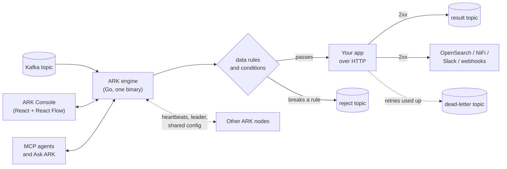

### [tack](https://github.com/raven-clown/tack): One Struct, Every Output

Everything is derived at registration from the handler's types; the request path runs precomputed plans only, and every generated artifact reads the same OpenAPI document.

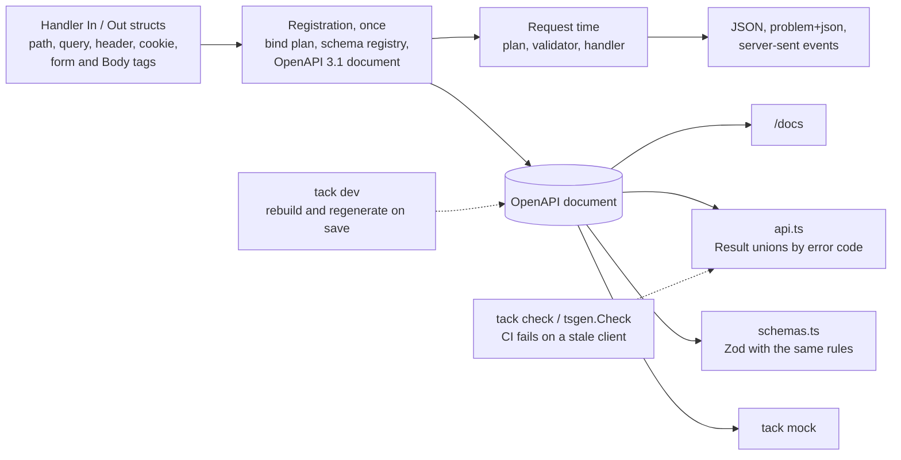

### Delta MES: CI/CD and Deployment

How code gets from a commit to a running service inside the air-gapped cluster.

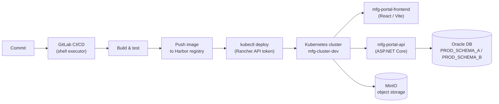

### Delta MES: CTP Diagnostic Tool, Yield Tracker, and Dashboard

Where the data actually comes from and how it reaches the screen.

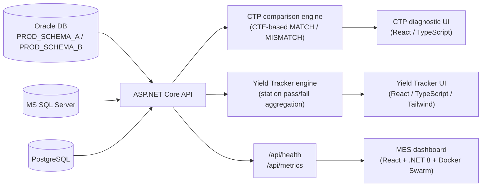

### Delta: AI OpenSearch Log Analytics

Only the new bytes of every log, parsed, searchable, and turned into Teams alerts while production is still affected.

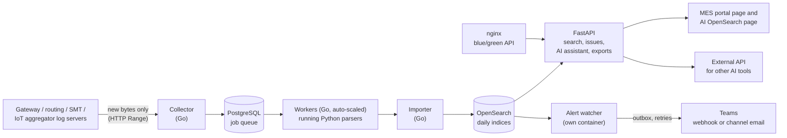

### Delta: AI Center, AI Deltron and AI Monitor

AI Center is the web portal for every AI project the team has built. AI Deltron answers from the company's own knowledge, and AI Monitor is the admin console behind both. The backend was split into services one step at a time.

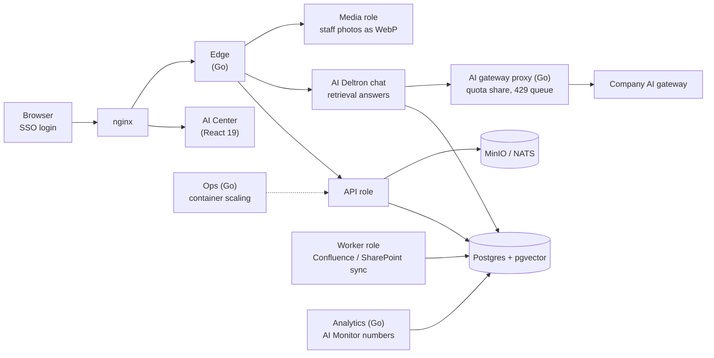

### Delta: AIFinance

Company matching for Finance: the same company found across SAP exports, put under its group, with every number from code.

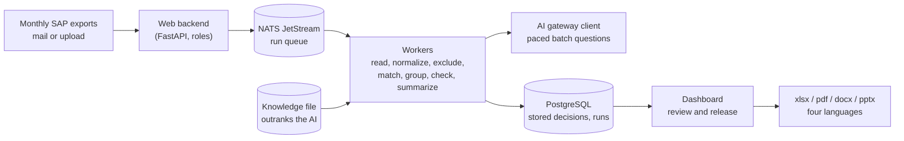

### Delta: Requirement Request Tracking

Requests that move through MES, AP, IT Server and OA review, stored as append-only snapshots.

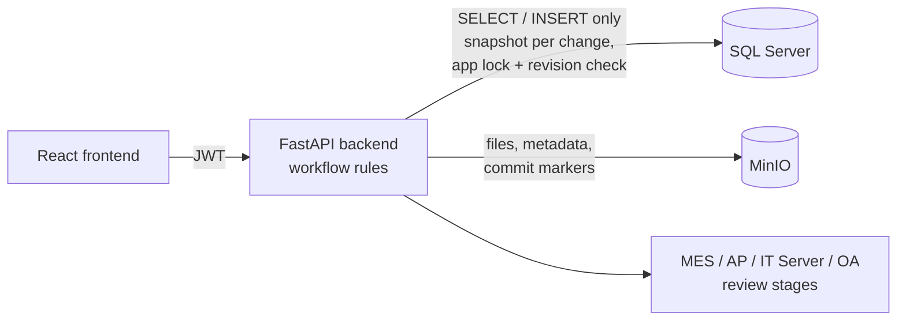

### Delta: Central Kafka and NiFi Platforms

Shared platforms other IT teams plug their apps into, and the data flows built on top of them.

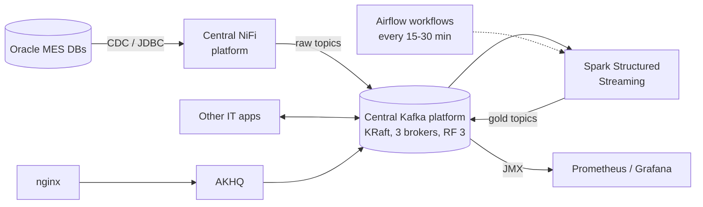

### FiveM Server Platform

Server, systems, and the storefront running alongside it.

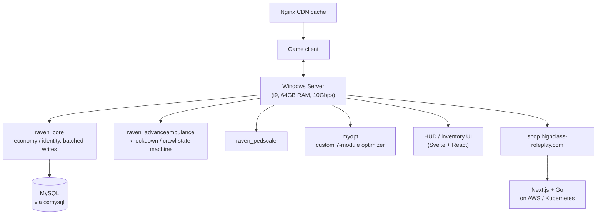

### [IdpForge](https://github.com/raven-clown/idpforge): Cluster-Safe Background Jobs and Realtime Fan-Out

How one binary stays correct whether it's a single instance or several behind a load balancer.

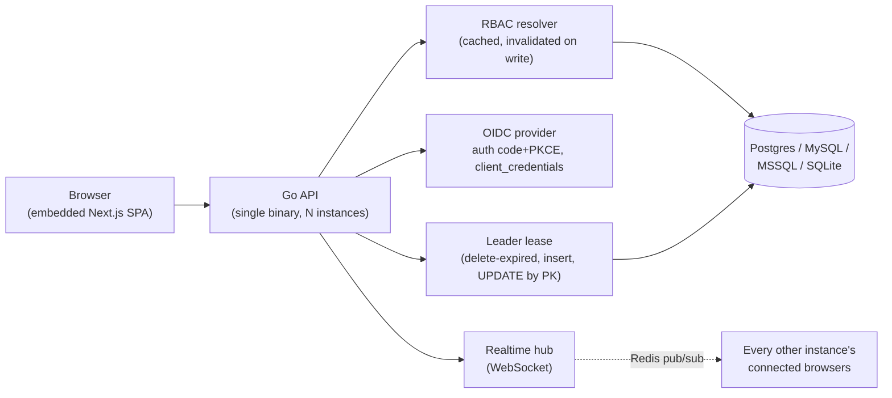

### Snippet Manager: Two Front-Ends, One Core

How the VS Code extension and the Electron app share state without a server.

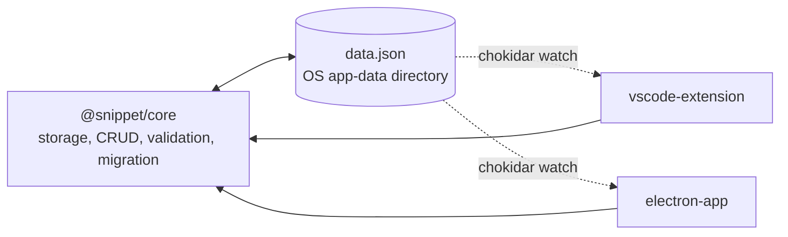

### [RoomedIn](https://www.roomedin.online/): Defense in Depth on a Status Change

Five independent layers between a tap on a phone and a row actually changing.

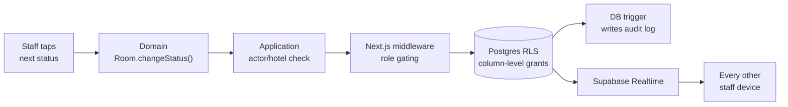
